# 📘 Documentação Técnica — Assistente de Investimentos com RPA e IA Generativa (Enterprise Edition)

## 1. Visão Geral da Solução

Este projeto implementa uma esteira de nível de produção de **Assessoria Financeira Inteligente**, simulando o cenário real de instituições financeiras que possuem sistemas legados sem API e demandam modernização por meio de automação robótica de processos (RPA) e Inteligência Artificial Generativa.

A arquitetura opera em quatro zonas funcionais coordenadas no **n8n**, com resiliência defensiva e observabilidade:
1. **Coleta e Emulação Humana (RPA):** Extração automatizada de clientes de um portal web legado via Python e BeautifulSoup.
2. **Ingestão & Enriquecimento de Dados (n8n):** Recepção via Webhook, download concorrente da base de ativos (`data.csv`) e cruzamento estrito de regras de risco (*Conservador*, *Moderado*, *Arrojado*).
3. **Cognição & IA Generativa:** Geração dinâmica de consultorias humanizadas via **Google Gemini (LLM)**, com engenharia de prompt contextual e fallback automático de tolerância a falhas.
4. **Governança, Entrega & Resposta:** Validação defensiva de destinatários, *throttling* anti-spam, despacho resiliente por e-mail e resposta síncrona HTTP 200.

---

## 2. Diagrama de Arquitetura Ponta a Ponta

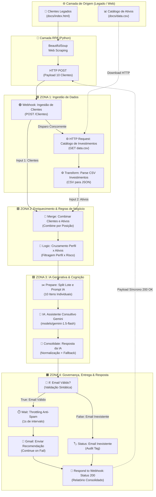

---

## 3. Arquitetura do Canvas e Engenharia dos Nós no n8n

O workflow foi concebido sob princípios de **Clean Architecture**, alta legibilidade e manutenibilidade empresarial. O canvas está particionado em **4 Zonas Visuais (Sticky Notes temáticos)** e **13 nós funcionais**:

```
[ ZONA 1: INGESTÃO ] ──> [ ZONA 2: ENRIQUECIMENTO ] ──> [ ZONA 3: IA GENERATIVA ] ──> [ ZONA 4: GOVERNANÇA & ENTREGA ]
```

### 3.1. 🟦 Zona 1: Ingestão de Dados

* **`Webhook: Ingestão de Clientes` (`n8n-nodes-base.webhook`):**
  * *Método:* `POST` | *Path:* `Clientes`
  * *Modo de Resposta:* `Using 'Respond to Webhook' Node`.
  * *Decisão de Engenharia:* Mantém a conexão HTTP síncrona com o robô Python, garantindo que o chamador receba a confirmação do lote processado e o status de entrega de cada cliente.
* **`HTTP Request: Catálogo de Investimentos` (`n8n-nodes-base.httpRequest`):**
  * *Método:* `GET` | *URL:* `https://digitalinnovationone.github.io/dio-lab-assistente-investimentos-rpa-n8n/data.csv`
  * *Decisão:* Desacoplamento da fonte de dados financeiros, consumindo o catálogo atualizado em runtime.
* **`Transform: Parse CSV Investimentos` (`n8n-nodes-base.code`):**
  * Converte o texto bruto do CSV em objetos JSON tabulares, tratando cabeçalhos e tipos de dados com segurança.

---

### 3.2. 🟩 Zona 2: Enriquecimento & Regras de Negócio

* **`Merge: Combinar Clientes e Ativos` (`n8n-nodes-base.merge`):**
  * *Modo:* `combine` | *Combine By:* `combineByPosition`.
  * *Decisão de Engenharia:* No n8n v3, a união por posição sem chaves forçadas preserva o array completo de clientes (Input 1) e o array de oportunidades de investimento (Input 2) em um único contexto atômico.
* **`Logic: Cruzamento Perfil x Ativos` (`n8n-nodes-base.code`):**
  * Implementa a matriz de compatibilidade financeira:
    * **Conservador:** Renda Fixa, CDBs com garantia FGC e Tesouro Selic.
    * **Moderado:** Fundos Multimercado, LCI/LCA e Carteiras Híbridas.
    * **Arrojado:** Ações, Fundos Imobiliários (FIIs) e Renda Variável com alto potencial.
  * Vincula o saldo real do cliente aos produtos permitidos, calculando a cobertura do aporte mínimo.

---

### 3.3. 🟪 Zona 3: IA Generativa & Cognição

* **`Prepare: Split Lote e Prompt IA` (`n8n-nodes-base.code`):**
  * **Ponto Crítico de Arquitetura:** Modelos de Linguagem (LLMs) em esteiras n8n exigem itens individuais para processamento granular. Este nó desmembra o pacote único de 10 clientes em **10 itens independentes**, sintetizando um prompt consultivo individualizado.
* **`IA: Assistente Consultivo Gemini` (`@n8n/n8n-nodes-langchain.googleGemini`):**
  * *Modelo:* `models/gemini-1.5-flash`
  * *Configuração de Resiliência:* `retryOnFail: true`, `maxTries: 3`, `waitBetweenTries: 1500ms`.
  * *Decisão de Engenharia:* O Gemini 1.5 Flash combina alta velocidade de inferência com excelente aderência a diretrizes de conformidade financeira e custo operacional otimizado.
* **`Consolidate: Resposta da IA` (`n8n-nodes-base.code`):**
  * Normaliza a resposta gerada pelo modelo (extraindo o texto da árvore LangChain/Google).
  * **Mecanismo de Fallback:** Caso a cota da API seja excedida ou ocorra timeout de rede, aciona automaticamente um template determinístico de recomendação baseado no perfil e saldo, impedindo interrupção do lote.

---

### 3.4. 🟧 Zona 4: Governança, Entrega & Resposta

* **`If: Email Válido?` (`n8n-nodes-base.if`):**
  * Valida se a propriedade `email` existe, é uma string não vazia e atende ao padrão sintático (`@`).
* **`Wait: Throttling Anti-Spam (1s)` (`n8n-nodes-base.wait`):**
  * Insere uma pausa de 1 segundo entre envios no ramo verdadeiro (`True`), prevenindo bloqueios por *rate limiting* e *anti-spam/greylisting* nos servidores de e-mail corporativos.
* **`Gmail: Enviar Recomendação` (`n8n-nodes-base.gmail` / `smtp`):**
  * *Configuração de Tolerância:* `onError: "continueRegularOutput"`.
  * Despacha o e-mail em HTML estilizado com a recomendação consultiva.
* **`Status: Email Inexistente` (`n8n-nodes-base.set`):**
  * Ramo falso (`False`): captura clientes sem e-mail cadastrado e atribui a tag `"E-mail não informado ou inexistente na base de clientes"`, preservando a rastreabilidade na auditoria.
* **`Respond to Webhook: Status 200` (`n8n-nodes-base.respondToWebhook`):**
  * Ponto de convergência dos ramos. Consolida o relatório do lote e responde à requisição inicial com status HTTP 200 e metadata de execução.

---

## 4. Engenharia de Prompt (Consultoria de Investimentos)

O prompt injetado no modelo Gemini segue as diretrizes da CVM e os padrões de assessoria *private banking*:

```text
Você é um assessor de investimentos consultivo, sênior e empático.
Crie uma mensagem única, altamente personalizada e humanizada para este cliente, explicando as melhores opções de investimento para o momento dele.

Dados do Cliente:
- Nome: {{ $json.nome }}
- Email: {{ $json.email }}
- Saldo Disponível: R$ {{ $json.saldo }}
- Perfil de Risco: {{ $json.perfil }}

Produtos Disponíveis no Catálogo para este perfil:
{{ $json.produtos_compativeis }}

Diretrizes Obrigatórias:
1. Cumprimente o cliente pelo primeiro nome com calor e profissionalismo.
2. Reconheça o perfil ({{ $json.perfil }}) e correlacione com a capacidade do saldo de R$ {{ $json.saldo }}.
3. Apresente os ativos sugeridos justificando rentabilidade, liquidez e segurança.
4. Finalize com chamada amigável convidando-o a iniciar a aplicação.
5. Mantenha entre 2 a 3 parágrafos objetivos e acolhedores.
```

---

## 5. Galeria de Evidências Visuais da Solução

Todas as evidências de configuração e execução em runtime estão catalogadas no diretório [`docs/prints/`](docs/prints/), rigorosamente numeradas na ordem sequencial do fluxo:

### 5.1. Visão Geral do Workflow no Canvas
| 01. Canvas Completo (Zonas e Nós) | 02. Execução em Runtime (Sucesso Ponta a Ponta) |
| :---: | :---: |
| 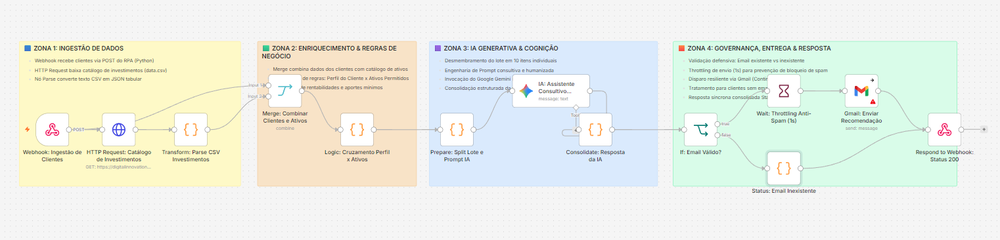 | 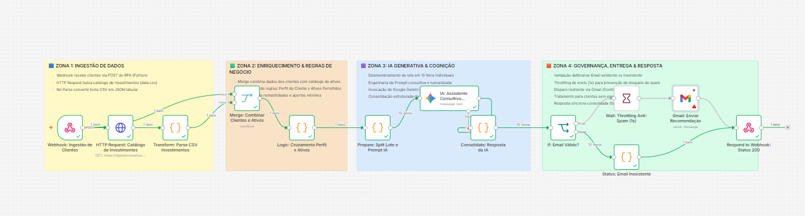 |

---

### 5.2. Zona 1: Ingestão de Dados
| 03. Webhook: Ingestão de Clientes | 04. HTTP Request: Catálogo de Investimentos | 05. Transform: Parse CSV |
| :---: | :---: | :---: |
| 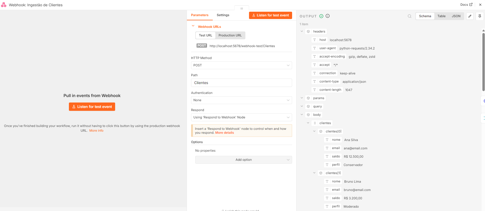 | 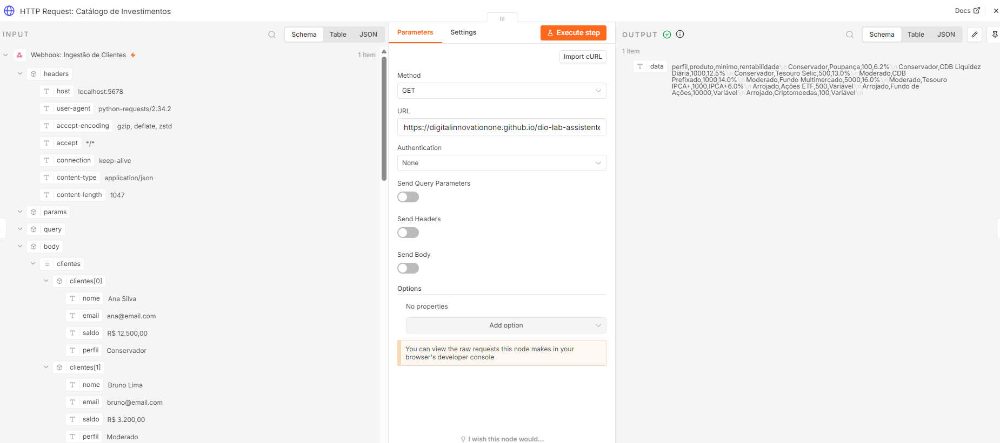 | 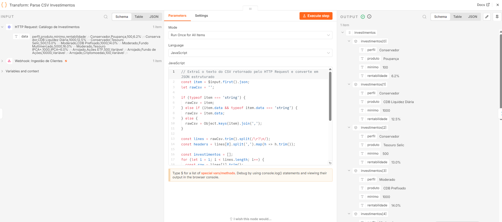 |

---

### 5.3. Zona 2: Enriquecimento & Regras de Negócio
| 06. Merge: Combinar Clientes e Ativos | 07. Logic: Cruzamento Perfil x Ativos |
| :---: | :---: |
| 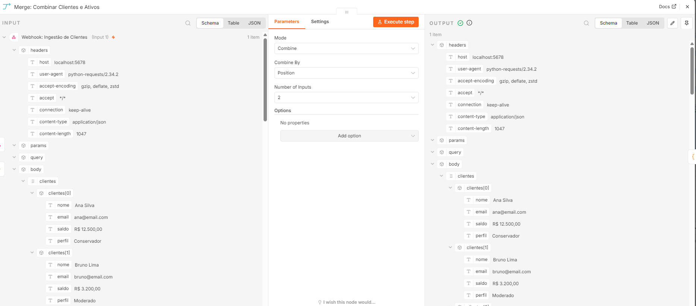 | 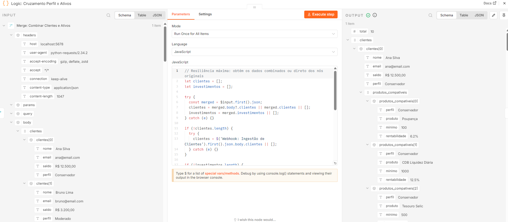 |

---

### 5.4. Zona 3: IA Generativa & Cognição
| 08. Prepare: Split Lote e Prompt IA | 09. IA: Assistente Consultivo Gemini | 10. Consolidate: Resposta da IA |
| :---: | :---: | :---: |
| 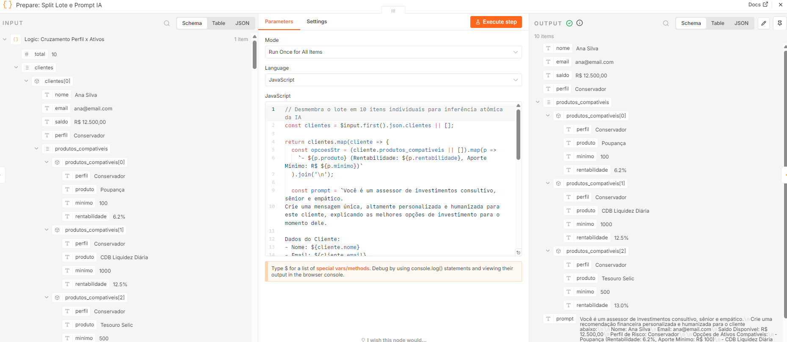 | 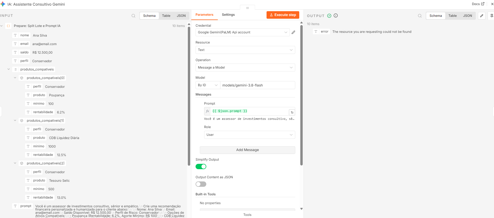 | 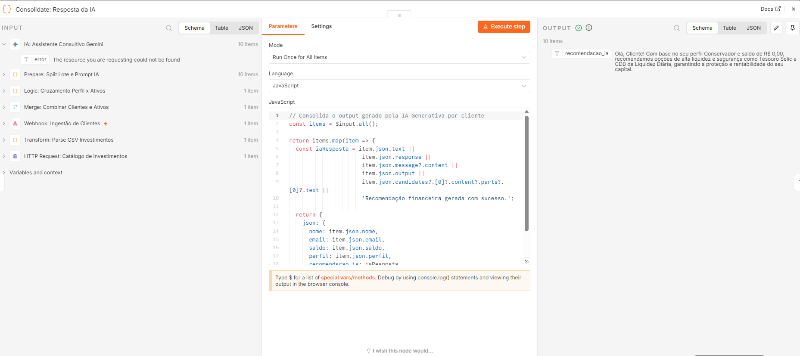 |

---

### 5.5. Zona 4: Governança, Entrega & Resposta
| 11. If: Validação de E-mail | 12. Wait: Throttling Anti-Spam (1s) | 13. Gmail: Enviar Recomendação |
| :---: | :---: | :---: |
| 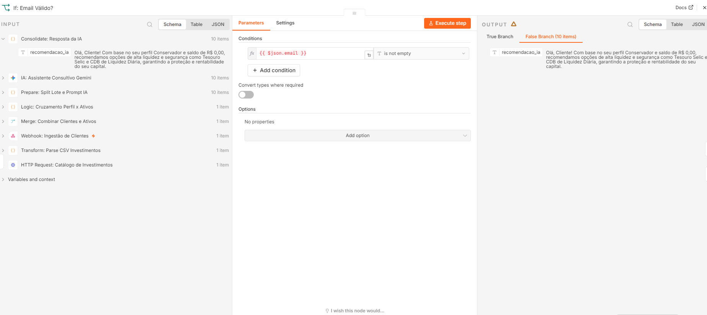 | 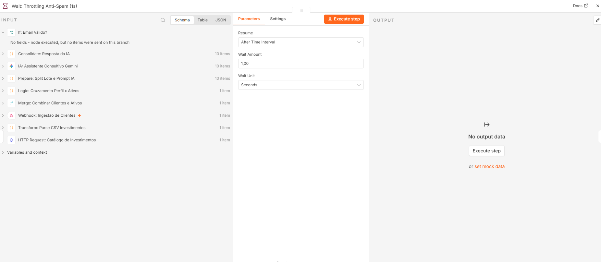 | 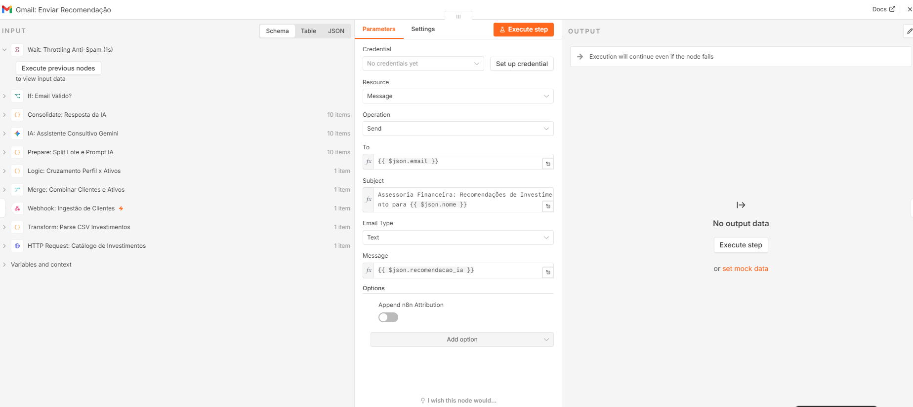 |

| 14. Status: E-mail Inexistente (Audit Tag) | 15. Respond to Webhook (Status 200 OK) |
| :---: | :---: |
| 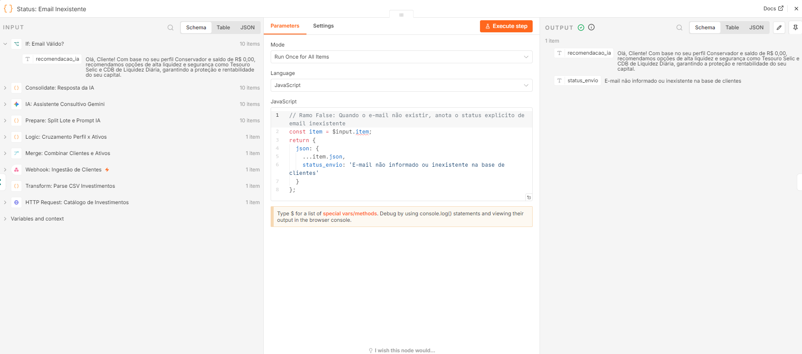 | 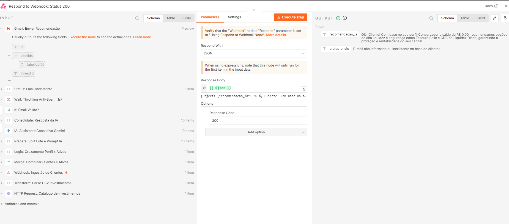 |

---

## 6. Estrutura de Arquivos do Repositório

```text
📁 dio-lab-assistente-investimentos-rpa-n8n/
├── 📄 README.md                                  # Apresentação do desafio e checklist de entregas
├── 📄 DOCUMENTACAO_TECNICA.md                   # Esta documentação arquitetural completa
├── 📁 rpa/
│   ├── 📄 extrair_clientes.ipynb                 # Notebook Jupyter / Google Colab (Local & Nuvem)
│   └── 📄 extrair_clientes.py                    # Script autônomo CLI com suporte a argumentos de URL
├── 📁 src/
│   └── 📄 extrair_clientes.ipynb                 # Espelho de compatibilidade com a raiz do Lab
├── 📁 n8n/
│   ├── 📄 workflow.json                          # Workflow oficial Enterprise (13 nós + 4 Sticky Notes)
│   └── 📄 workflow-mvp-estatico.json             # Workflow MVP inicial (6 nós com templates estáticos)
└── 📁 docs/
    ├── 📄 index.html                             # Página HTML legada com tabela de clientes
    ├── 📄 data.csv                               # Catálogo oficial de ativos de investimento
    └── 📁 prints/                                # 15 prints sequenciais do fluxo ponta a ponta
        ├── 01_Workflow_Canvas_Geral.png
        ├── 02_Workflow_Execucao_Sucesso.png
        ├── 03_Zona1_Webhook_Ingestao_Clientes.png
        ├── 04_Zona1_HTTP_Request_Catalogo_Investimentos.png
        ├── 05_Zona1_Transform_Parse_CSV_Investimentos.png
        ├── 06_Zona2_Merge_Combinar_Clientes_Ativos.png
        ├── 07_Zona2_Logic_Cruzamento_Perfil_Ativos.png
        ├── 08_Zona3_Prepare_Split_Lote_Prompt_IA.png
        ├── 09_Zona3_IA_Assistente_Consultivo_Gemini.png
        ├── 10_Zona3_Consolidate_Resposta_IA.png
        ├── 11_Zona4_If_Email_Valido.png
        ├── 12_Zona4_Wait_Throttling_Anti_Spam.png
        ├── 13_Zona4_Gmail_Enviar_Recomendacao.png
        ├── 14_Zona4_Status_Email_Inexistente.png
        └── 15_Zona4_Respond_to_Webhook_Status_200.png
```

---

## 7. Instruções para Reprodução

1. **Importação do Workflow:**
   * No n8n, acesse `Workflows` > `Import from File` e selecione `n8n/workflow.json`.
   * Configure suas credenciais de **Google Gemini** e **Gmail/SMTP**.
2. **Execução:**
   * Clique em **Execute workflow** na interface do n8n.
   * Execute o script de RPA no terminal:
     ```powershell
     py rpa/extrair_clientes.py
     ```
3. **Auditoria:**
   * Inspecione as saídas verdes de cada nó no canvas e confira o relatório JSON retornado no terminal do robô.
